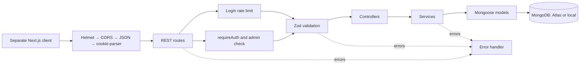
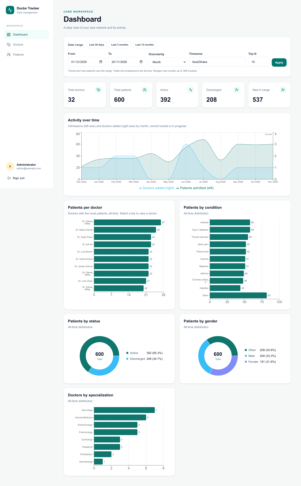
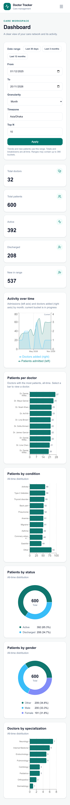
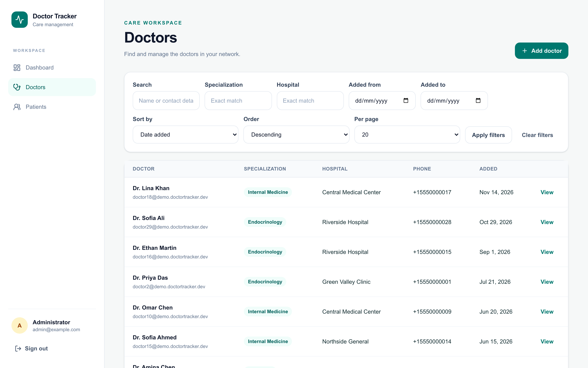
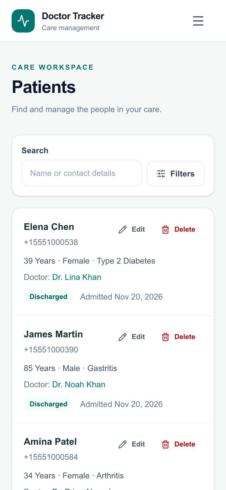

# Doctor Tracker API

## Elevator pitch

Doctor Tracker is an administrative application for securely managing doctors and their patients. This standalone Express REST API handles authentication, validated record workflows, and dashboard aggregations in MongoDB for a separate responsive Next.js client.

- Backend repository: https://github.com/amitavrchy/doctor-tracker-backend
- Frontend repository: https://github.com/amitavrchy/doctor-tracker-frontend

## Features

- Admin login, protected routes, and session revocation.
- Create and browse doctors; search, filter, paginate, and manage patients under a doctor.
- Browse, search, filter, edit, and delete patients.
- Dashboard totals, breakdowns, top doctors, and timezone-aware trends.
- Health endpoint and consistent JSON responses.

## Tech stack

Node.js, Express 5.3.0, TypeScript 5.9.3, MongoDB with Mongoose 9.12.2, Zod 4.6.7, bcryptjs 3.0.3, jsonwebtoken 9.0.3, Helmet 8.3.0, and express-rate-limit 8.7.5. Versions are declared package versions; see `package.json` for the complete list.

## Setup guide

Prerequisites: Node.js 20.19 or newer (Node 20+) and npm, and a reachable MongoDB Atlas or local MongoDB instance. The dashboard uses MongoDB's `$dateTrunc` operator (MongoDB 5.0+).

1. Clone and install:

   ```sh
   git clone https://github.com/amitavrchy/doctor-tracker-backend.git
   cd doctor-tracker-backend
   npm install
   cp .env.example .env
   ```

2. Configure `.env` with your own values. Do not commit it.

   | Variable | Purpose |
   | --- | --- |
   | `NODE_ENV` | `development`, `production`, or `test`; defaults to `development`. |
   | `PORT` | Positive server port; defaults to `5000`. |
   | `MONGODB_URI` | Required MongoDB connection string for your own instance. |
   | `MONGODB_DB_NAME` | Database name; defaults to `doctor-tracker`. |
   | `JWT_SECRET` | Required signing secret, at least 32 characters; generate a long random value. |
   | `CLIENT_URL` | Comma-separated allowed frontend origins; defaults to `http://localhost:3000`. Include the actual browser origin, including its port. |
   | `COOKIE_SAME_SITE` | `lax`, `strict`, or `none`; defaults to `lax`. `none` requires secure cookies. |
   | `COOKIE_SECURE` | `true` or `false`; defaults to `false`. Use `true` with HTTPS. |
   | `TRUST_PROXY` | `true` or `false`; defaults to `false`. Enable when deployed behind a trusted proxy. |
   | `ADMIN_EMAIL` | Email for the admin seed, for example `admin@example.com`. |
   | `ADMIN_PASSWORD` | Admin seed password: at least 12 characters, at most 72 characters and 72 UTF-8 bytes. |
   | `ADMIN_NAME` | Non-empty admin display name for the seed. |

3. Run `npm run seed:admin`. It creates or updates the admin identified by email; rerunning it increments `tokenVersion` and signs out that admin's existing sessions.
4. Optionally run `npm run seed:demo` to create demo doctors and patients. If demo doctors already exist, it makes no changes. `npm run seed:demo -- --reset` deletes doctors on the demo email domain and their patients before recreating the demo data; it never deletes users.
5. Run `npm run dev` (default port 5000), then start the [frontend](https://github.com/amitavrchy/doctor-tracker-frontend#setup-guide). For production use `npm run build` and `npm run start`.

Quality commands: `npm run lint`, `npm run typecheck`, `npm run format:check`, and `npm run format` (writes formatting under `src`).

## System architecture



Health is public. Login is rate-limited and validated; `/auth/me`, logout, and the data routes require authentication. The frontend can proxy `/api` through Next.js, but the API is a separate server.

```text
src/
  config/       environment and database connection
  routes/       endpoint and middleware wiring
  middlewares/  authentication, validation, errors, not-found
  validators/   Zod request schemas
  controllers/  HTTP adapters
  services/     business logic and queries
  models/       Mongoose schemas and indexes
  scripts/      admin and demo seeds
  utils/        errors, JWT, responses, async wrapper
```

## API reference

All paths are relative to the server origin. Protected endpoints accept the `token` cookie or a Bearer token. Login accepts email and password and sets the cookie; it does not return a token in the response.

| Method | Path | Auth | Description / key query parameters |
| --- | --- | --- | --- |
| GET | `/api/health` | Public | Uptime, timestamp, and database connection state. |
| POST | `/api/auth/login` | Public | Sign in with `email` and `password`. |
| POST | `/api/auth/logout` | Admin | Revoke the admin's sessions and clear the cookie. |
| GET | `/api/auth/me` | Admin | Current authenticated user. |
| GET | `/api/doctors` | Admin | List; `q`, `from`, `to`, `specialization`, `hospital`, `page`, `limit`, `sortBy`, `order`. Dates filter creation time. |
| POST | `/api/doctors` | Admin | Create a doctor. |
| GET | `/api/doctors/:id` | Admin | Doctor detail and patient count. |
| GET | `/api/doctors/:id/patients` | Admin | List that doctor's patients; patient list parameters below apply. The path doctor takes precedence over `doctor`. |
| POST | `/api/doctors/:id/patients` | Admin | Add a patient to a doctor. |
| DELETE | `/api/doctors/:id/patients/:patientId` | Admin | Delete a patient belonging to that doctor. |
| GET | `/api/patients` | Admin | List; `q`, `from`, `to`, `doctor`, `condition`, `gender`, `status`, `page`, `limit`, `sortBy`, `order`. Dates filter admission time. |
| GET | `/api/patients/:id` | Admin | Patient detail, including notes. |
| PATCH | `/api/patients/:id` | Admin | Update patient fields or doctor. |
| DELETE | `/api/patients/:id` | Admin | Delete a patient. |
| GET | `/api/dashboard` | Admin | Aggregates; `from`, `to`, `granularity` (`day`, `week`, `month`), `tz` (IANA timezone), `limit`. |

Lists default to page 1, limit 20 (maximum 100), descending creation time; valid doctor sort fields are `createdAt`, `name`, `specialization`, `hospital`, and patient sort fields are `createdAt`, `admissionDate`, `name`, `condition`. Search is case-insensitive substring matching; specialization, hospital, and condition filters are case-insensitive exact matches. List date-only upper bounds include the entire UTC day. Dashboard date-only bounds use the requested timezone.

Success responses are `{ "success": true, "data": ... }`; paginated responses also include `meta: { page, limit, total, totalPages }`. Errors have `{ "success": false, "error": { "code": "...", "message": "...", "details": ... } }`, with `details` only when available. Common statuses: 200 success, 201 created, 400 validation or malformed JSON, 401 unauthenticated, 403 forbidden, 404 not found, 409 duplicate value, 429 login rate limit, and 500 internal error. Deletes return 200 with `data: null`.

## Data models and indexes

All models have `createdAt` and `updatedAt` timestamps.

- **User:** name, unique lowercase email, passwordHash, role (`admin`), tokenVersion. The unique email index supports account lookup and uniqueness.
- **Doctor:** name, specialization, hospital, phone, unique lowercase email. The unique email index enforces uniqueness. `{ createdAt: -1, _id: -1 }` supports chronological browsing; `{ specialization: 1, createdAt: -1, _id: -1 }` and `{ hospital: 1, createdAt: -1, _id: -1 }` support respective equality filters and default sorting.
- **Patient:** doctor reference, name, age, gender, phone, optional email, condition, admissionDate, optional notes, status. `{ doctor: 1, createdAt: -1, _id: -1 }` and `{ condition: 1, createdAt: -1, _id: -1 }` support filtered default sorting; `{ createdAt: -1, _id: -1 }` supports chronological browsing; `{ admissionDate: -1, _id: -1 }` supports admission-date ranges and sorting; `{ doctor: 1, admissionDate: -1, _id: -1 }` and `{ condition: 1, admissionDate: -1, _id: -1 }` support those filters combined with admission dates.

Doctor and patient schemas use English collation at strength 2 for case-insensitive equality and compatible indexes. Regex substring searches and other sort/filter combinations may not benefit from these indexes; inspect query plans for the actual workload.

## Dashboard aggregation

Independent counts and aggregations run in parallel. A patient `$facet` computes condition, status, and gender breakdowns; the top-doctor pipeline groups, sorts, and limits before `$lookup`. Trends use `$dateTrunc` with the requested timezone (weeks start Monday); the service fills missing buckets with zero. Validation caps the requested range at 366 buckets. Breakdowns are all-time, while trends and new-patient counts use the inclusive range.

## Security

Passwords are hashed with bcrypt. An eight-hour JWT is stored in an httpOnly cookie; the API also accepts Bearer tokens obtained securely elsewhere. Each authenticated request checks the admin role and `tokenVersion`; logout or reseeding revokes that admin's sessions. Helmet, a credentialed CORS allow-list, a 10-attempt/15-minute login rate limit, strict Zod request schemas, and Origin checks on login and cookie-authenticated mutations with an Origin header provide additional layers. Keep secrets in local environment files or the hosting secret store, never in the repository.

## Deployment notes

Host the client and Express server separately. Set `CLIENT_URL` to the frontend origin (or comma-separated allowed origins), configure the frontend rewrite to reach the API, and use HTTPS with `COOKIE_SECURE=true`. Use `COOKIE_SAME_SITE=lax` when the frontend proxies `/api` through its same-origin rewrite; direct cross-site calls need `none` plus secure cookies and compatible browser policies. Set `TRUST_PROXY=true` behind a trusted proxy, configure MongoDB Atlas network access if using Atlas, and run `npm run seed:admin` once using deployment secrets.

## Technical decisions

### Validation and service layer

**Context:** HTTP input must be checked before database operations while business logic remains reusable. **Options:** Put validation and queries directly in controllers, or separate request schemas and services. **Decision:** Zod validates strict request bodies and queries, controllers adapt HTTP, and services implement queries and business rules. **Trade-offs:** There are more files and schema/model constraints must remain aligned, but responsibilities and error handling are easier to review.

### Indexes and aggregations

**Context:** Lists and dashboards need useful performance as records grow. **Options:** Load records into the application and compute totals there, or use database indexes and aggregation pipelines. **Decision:** Compound indexes target common equality filters and chronological sorts; MongoDB aggregates counts and trends, with independent operations in parallel and a limited lookup. **Trade-offs:** Indexes consume storage and add write cost, while aggregation complexity and arbitrary substring searches still need profiling with real data.

### Cookie authentication and token versions

**Context:** Browser sessions need revocation without storing a token in JavaScript. **Options:** Local storage bearer tokens or stateless JWTs alone simplify some clients but increase script exposure or complicate immediate revocation. **Decision:** An httpOnly cookie carries a JWT and each request checks the user's token version. **Trade-offs:** Each authenticated request reads the user, and logout revokes all that admin's sessions; cookie and Origin settings require careful deployment configuration.

## Visual evidence

The screenshot email is masked as `admin@example.com`. See the [frontend gallery](https://github.com/amitavrchy/doctor-tracker-frontend#visual-evidence) for all views.

| View | Desktop | Mobile |
| --- | --- | --- |
| Dashboard |  |  |
| Doctors and patients |  |  |

## Known limitations

- Only the admin role is supported; there is no doctor edit or delete endpoint.
- Specialization, hospital, and condition filters are exact matches; a patient's email cannot be cleared once set.
- Dashboard breakdowns are all-time while trends use the selected range; logout revokes all sessions for that admin.
- Reviewer credentials are supplied separately with the submission and must never be committed.
